# Text Art Studio

Turns pictures, GIFs and videos into text art (braille, ASCII, blocks, emoji …) and back into
pictures, animations or chat-ready text. Everything runs on your own computer — nothing is uploaded.

## Just want to try it?

**Windows** — download **`text-art-studio-…-setup.exe`** from the
[latest release](https://github.com/ZeronTwoi/text-art-converter/releases/latest) and
**double-click it**. That's all: it installs and opens like any other program.
Prefer no installation? Take **`…-portable.exe`** instead — one file, double-click, it runs.

> Windows may show *"Windows protected your PC"* because the download is not code-signed.
> Click **More info → Run anyway**. If you want to be sure, compare the file with
> `SHA256SUMS.txt` from the same release.

**Linux** — download the **`.AppImage`** from the
[latest release](https://github.com/ZeronTwoi/text-art-converter/releases/latest), make it
executable (right-click → Properties → *Allow executing file as program*, or `chmod +x`), and
double-click it. A `.deb` package is there too.

**Any browser, no download manager, no install** — the whole app is one file:
`web/index.html`. Get the source (green **Code** button → *Download ZIP*), unpack it, and open
`web/index.html` in Chrome, Edge or Firefox. It works offline.

## Examples

The app itself — every look card previews **your** picture, and the Share panel checks the text
for the chat app you choose:

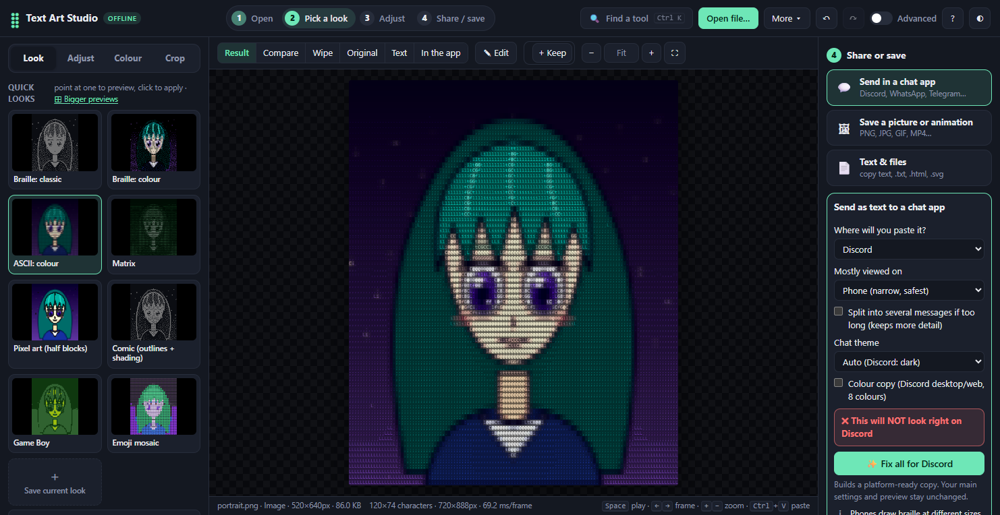

Before and after — four illustrations, four different looks (all files are in
[`examples/`](examples/)):

| The source | The text art |
| --- | --- |
| 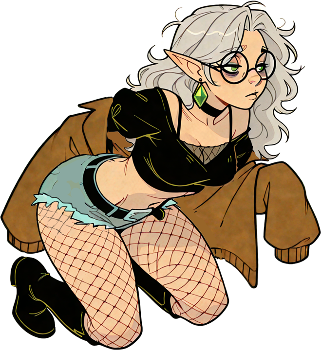 | **Pixel art**<br>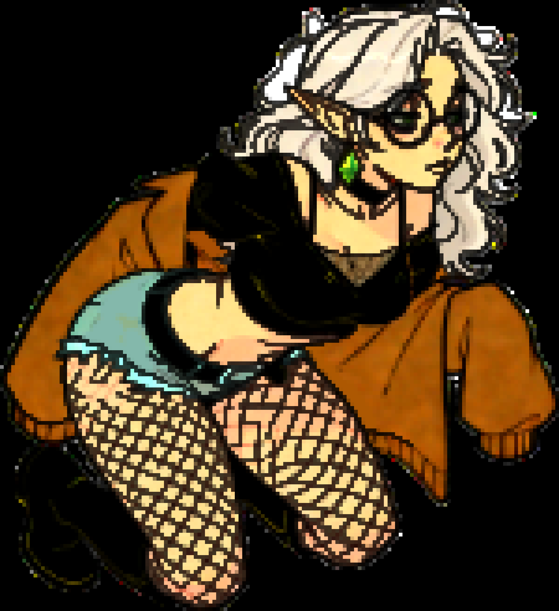 |
| 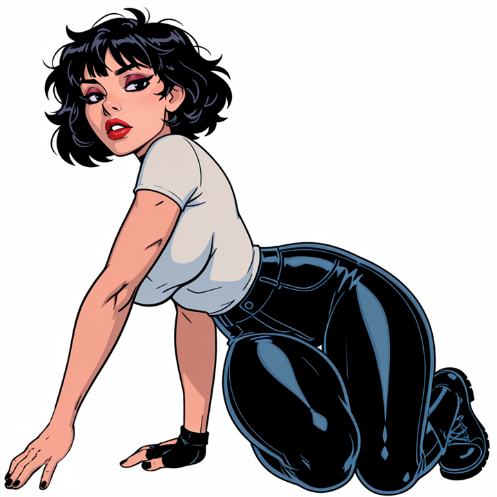 | **Dots**<br>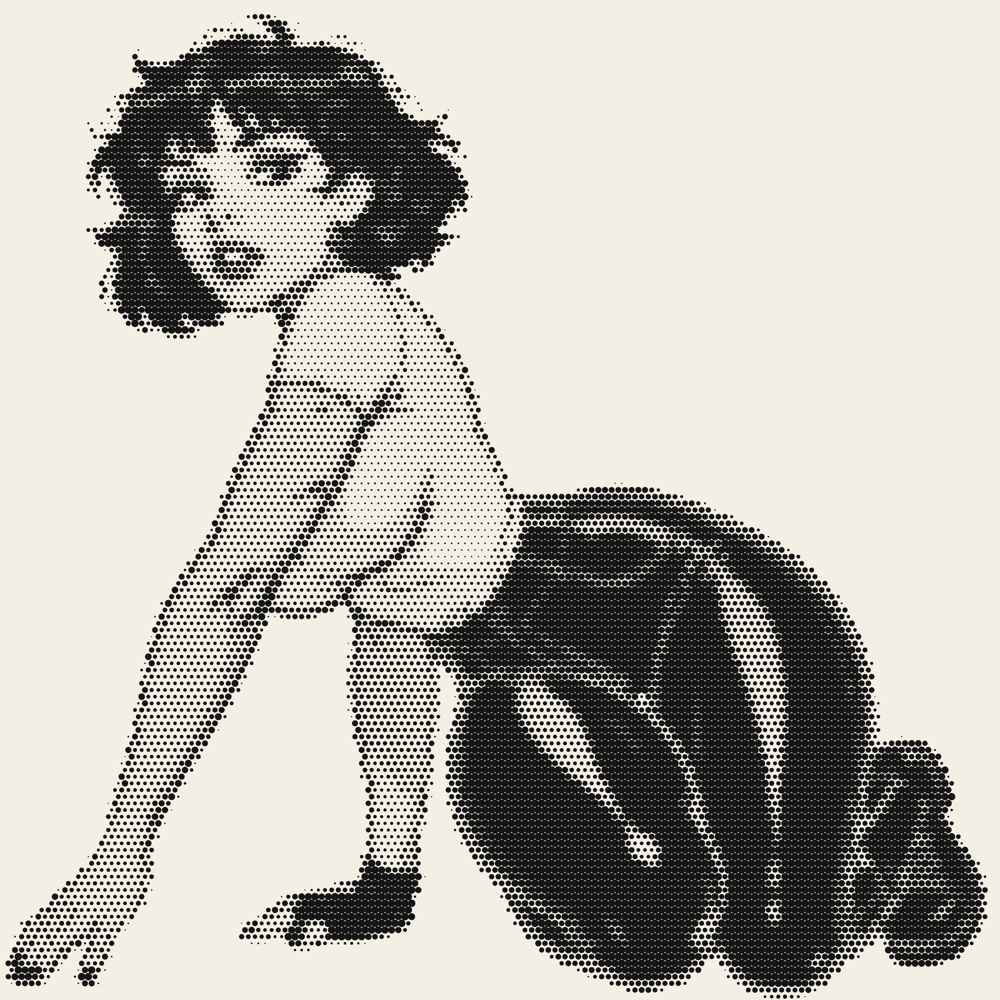 |
| 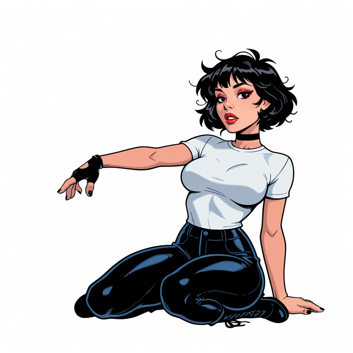 | **Letters**<br>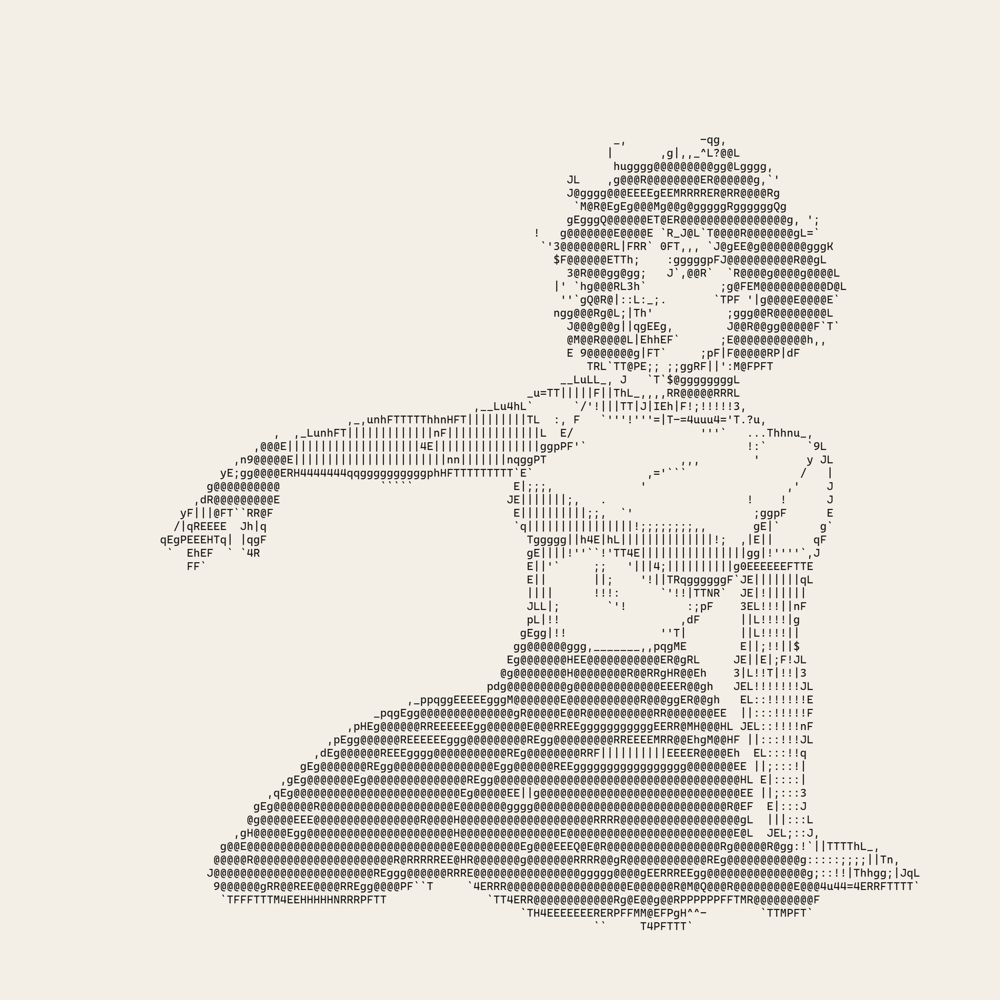 |
| 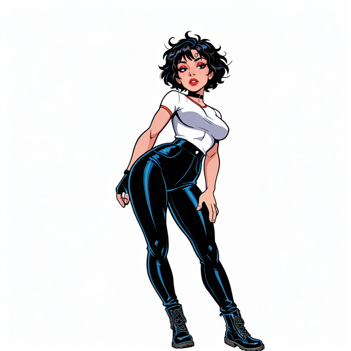 | **Emoji**<br>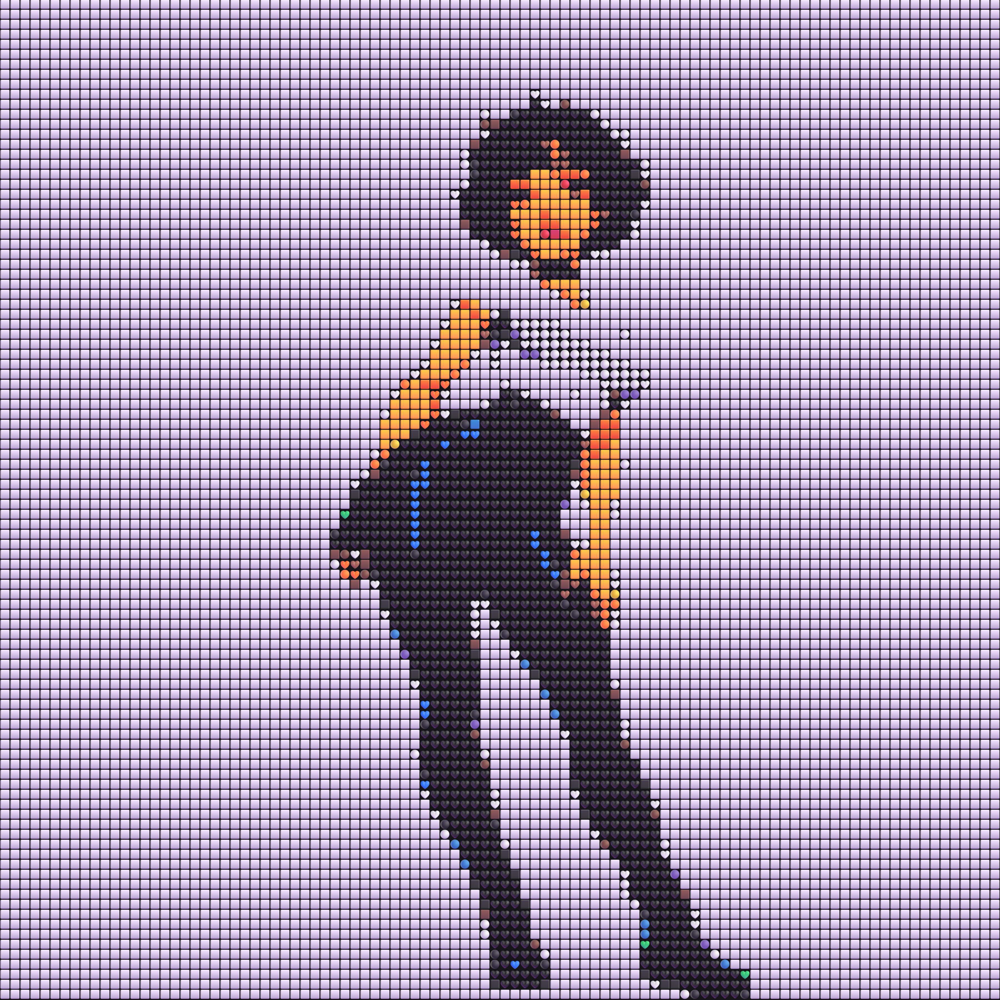 |

A photo — one source, three looks (NASA, 1984):

| | |
| --- | --- |
| **The source**<br>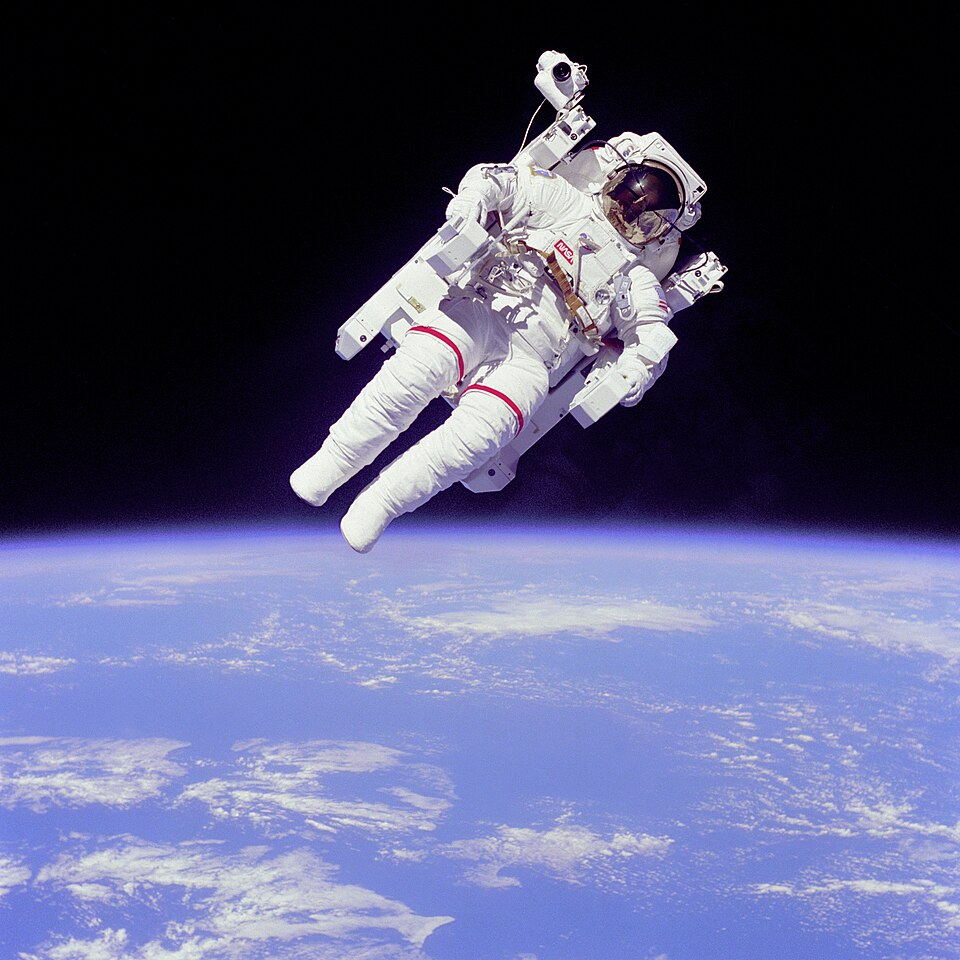 | **Braille: classic**<br>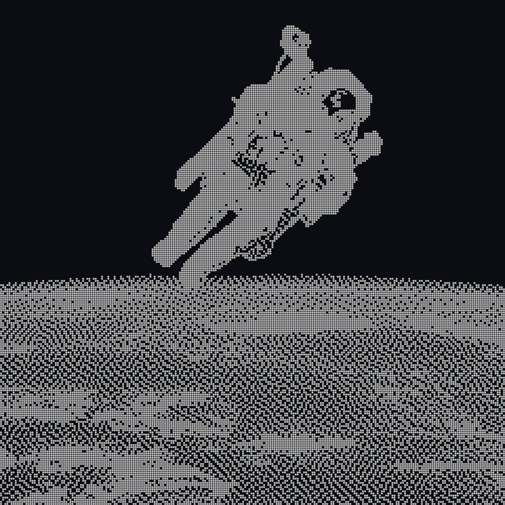 |
| **Matrix**<br>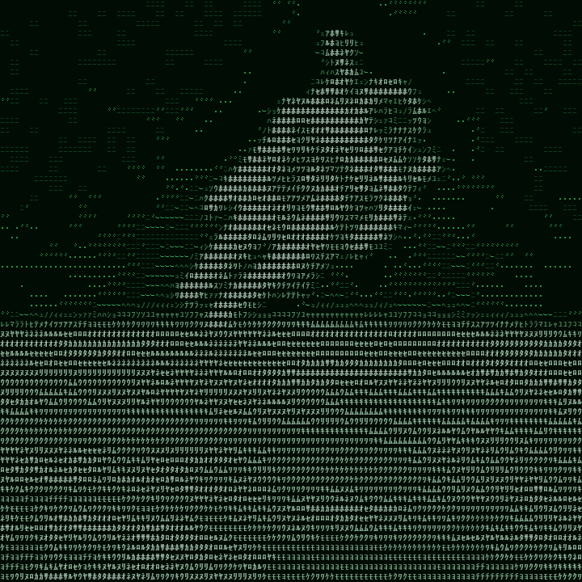 | **Halftone print**<br>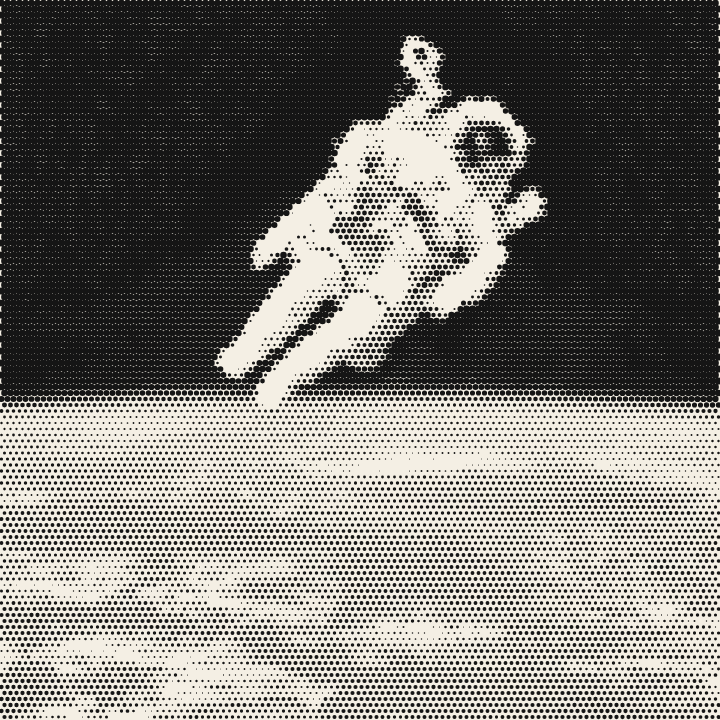 |

And the text itself: the picture below, adapted for Discord — paste
[Standing-Text.txt](examples/Standing-Text.txt) into a chat and it shows as braille dots.

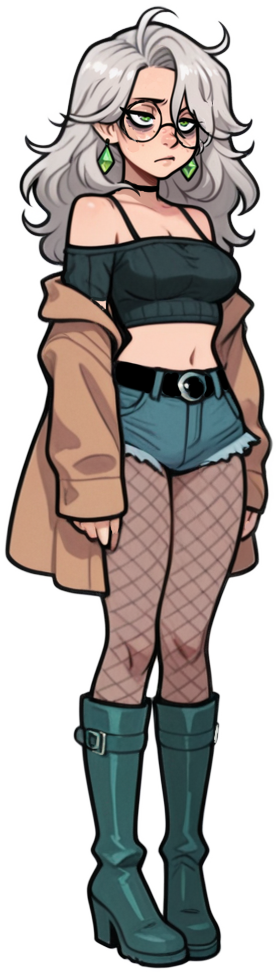

<details><summary><b>Show the chat-ready text</b></summary>

```text
⠀⠀⠀⠀⠀⠀⠀⠀⠀⠀⠀⠀⠀⠀⠀⠀⡠⣒⣒⣢⠀⠀⠀⠀⠀⠀⠀⠀⠀⠀⠀⠀
⠀⠀⠀⠀⠀⠀⠀⠀⠀⠀⠀⠀⢀⡠⣄⣺⣿⣿⡿⢶⣢⣄⠀⠀⠀⢠⡄⠀⠀⠀⠀⠀
⠀⠀⠀⠀⠀⠀⠀⠀⠀⢀⣴⠮⠛⣿⣗⣿⣿⣿⣿⣟⢿⡝⠿⣢⣤⣾⡿⠀⠀⠀⠀⠀
⠀⠀⠀⠀⠀⠀⠀⠀⢠⡿⠁⠀⠘⠉⣻⣍⣯⣟⣶⣿⡇⠉⢰⣌⢻⣿⡀⠀⠀⠀⠀⠀
⠀⠀⠀⠀⠀⠀⠀⠀⣾⠃⣠⣴⢆⢰⠟⣾⠋⠀⠀⢉⡿⠀⢸⣿⣏⠻⣿⠀⠀⠀⠀⠀
⠀⠀⠀⠀⠀⠀⠀⢰⡽⣼⡿⣳⣿⣿⣼⣯⣤⣤⣤⣼⢧⣿⠈⣿⣿⢹⡿⡀⠀⠀⠀⠀
⠀⠀⠀⠀⠀⠀⣀⣺⣿⣯⣴⣿⢿⣳⣷⣿⣿⣿⣿⢹⣼⣿⣶⡀⣿⣦⣣⣇⢀⠀⠀⠀
⠀⠀⠀⠀⠀⠀⡲⡿⣛⣩⣿⣿⣿⣿⣿⣛⠻⣻⡿⠛⣿⣿⢷⣷⣼⣶⡭⣽⠷⠃⠀⠀
⠀⠀⠘⢾⣷⣮⣻⠿⣿⣿⠟⣿⣿⣿⣍⠉⠋⠉⠘⠳⠟⠷⣞⣿⣿⣿⣷⣣⢔⡔⠀⠀
⠀⠀⢀⣾⣟⣅⣠⣾⢿⣷⡄⣿⣿⠏⣿⣷⣄⡘⠛⢉⣥⣾⣿⣿⡅⢻⡍⣿⣯⡀⠀⠀
⠀⠀⣿⣵⡟⣾⢻⠇⠘⢿⣿⣮⢿⣶⣷⡮⡷⠭⡟⠛⣯⣛⣿⠗⣿⣾⠹⣮⠛⣷⡀⠀
⠀⠀⠻⢿⣷⡛⢾⣧⣴⠟⠛⠛⢻⣿⣽⣿⣏⠉⠿⣦⣬⣟⣷⡾⠿⠋⢀⣿⣇⣾⠃⠀
⠀⠀⠆⣆⡨⣾⢀⢰⡏⠀⠀⠀⠀⠘⣿⡄⠈⠉⠓⠒⠚⢿⣏⠻⣦⠀⡿⡛⠒⠁⠀⠀
⠀⠀⠈⠻⡿⡷⠟⢸⡇⠀⠀⠀⠀⣴⣘⣿⣤⠤⠤⠶⠤⠤⢿⣷⣿⣠⣜⢷⡴⡀⠀⠀
⠀⠀⠀⠀⢻⢇⣦⣿⠛⠛⣛⡿⠿⡟⠉⠉⠀⠀⠀⠀⠀⠀⠀⠉⠙⠿⣟⡟⠋⠀⠀⠀
⠀⠀⠀⠀⠀⡹⣿⣿⠀⠀⢸⠘⣾⠀⠀⠀⠀⠀⠀⠀⠀⠀⠀⠀⠀⠀⠈⡞⡀⠀⠀⠀
⠀⠀⠀⠀⢨⢏⠛⠻⢶⣤⣸⠀⡼⠀⠀⠀⠀⠀⠀⠀⠀⠀⠀⠀⠀⠀⣠⡷⡁⠀⠀⠀
⠀⠀⠀⠀⣜⡎⠀⠀⠀⠉⠻⣷⣧⠀⠀⠀⠠⠖⠒⠒⠉⠉⠓⠒⠶⣿⡿⠈⣻⡃⠀⠀
⠀⠀⠀⠀⠫⡗⡶⠶⠶⠶⠶⣬⣻⣅⢀⣀⣀⠤⠴⠶⠶⠶⠶⠶⢶⣿⢀⣼⢹⠀⠀⠀
⠀⠀⠀⠀⡰⡽⠾⠽⣯⣿⢿⣿⣿⢿⣬⠇⠀⠀⠀⠀⠀⠀⠀⠀⣾⣷⣿⠿⣼⠀⠀⠀
⠀⠀⠀⠀⣿⡋⣳⠀⠀⣙⠿⣿⣿⢸⣋⣀⠀⠀⠀⠀⠀⢰⡟⠀⢻⣟⡞⢰⢳⣣⠀⠀
⠀⠀⠀⠀⠱⡳⡇⠀⠀⢏⢧⡙⢿⠀⠀⠀⠉⢩⢿⠓⢲⣶⢷⣾⣿⡍⡇⡜⠀⢫⡆⠀
⠀⠀⠀⠀⠀⡇⡇⠀⠀⠘⣆⢳⡀⣿⠒⢲⣤⣼⣎⣀⣸⣿⣀⣿⣸⣷⣿⡅⠀⢸⢸⠀
⠀⠀⠀⠀⢰⣁⣇⠀⠀⠀⠘⣆⢹⣿⣶⣿⠟⠉⠉⠀⠈⣿⠛⡟⠈⠉⢻⣿⡄⢸⢸⠀
⠀⠀⠀⢀⢦⣿⠋⠳⣄⠀⠀⠘⣆⢸⣧⣄⡀⠀⠀⠀⠀⣿⢠⡇⠀⣠⣴⣿⣧⡸⡼⡀
⠀⠀⠀⣌⡇⣿⠀⣀⣈⡇⠀⠀⠘⣾⡷⣯⣿⢶⣄⠀⠀⣿⡾⠃⠛⣛⡿⠚⣹⡯⢿⢱
⠀⠀⠰⡜⡇⢿⣿⣅⣤⠖⠋⠉⠙⣾⡟⠻⢾⣷⣤⣤⣤⣿⣖⣿⣾⡷⠿⢻⡟⠁⣮⠃
⠀⢀⢷⠁⢹⠈⣿⠘⣮⣷⠶⠾⠿⢿⣇⠀⠀⠉⠻⣯⠟⣛⡽⢋⠀⠀⠀⠈⣿⠛⡟⡄
⠀⡘⡏⠀⠀⡇⣿⣿⣹⠆⠀⠀⠀⠀⣿⠀⠀⠀⠀⢻⡴⣻⠗⠋⠀⠀⠀⠀⣿⠀⡽⡇
⢀⢿⠁⠀⠀⢹⢿⣭⣅⣀⣀⣀⣤⣴⡿⣀⣀⠀⠀⢸⡏⠁⠀⠀⠀⠀⠀⢸⣿⣵⡽⠀
⢸⡞⠀⠀⠀⠸⣼⡈⠻⣯⣽⡟⢻⢸⡟⢧⣼⢶⡀⢸⡇⠀⠀⠀⠀⢀⡀⣼⣯⢷⠁⠀
⡎⡇⠀⠀⠀⢀⢿⢧⡀⠈⠙⣻⣿⡿⣶⡋⣻⡏⠀⣼⠇⠀⠀⣀⣴⣫⣿⡿⠉⡿⡀⠀
⠘⢽⣦⢄⣀⣸⣸⠀⠉⠉⣿⢹⣏⣷⣿⠻⣧⡽⠀⣿⢀⣤⠾⣧⡿⢻⣾⣇⡤⡧⠃⠀
⠀⠀⠀⠉⠉⠒⣵⣄⣀⣀⣿⠘⣾⢥⠽⠛⠁⠀⢸⣿⣯⣽⢿⣏⣿⡿⡕⠊⠉⠀⠀⠀
⠀⠀⠀⠀⠀⠀⠈⠉⠐⠒⠛⢏⡟⠀⠀⠀⠀⠀⣾⢿⣟⣷⣾⣻⣷⡻⠀⠀⠀⠀⠀⠀
⠀⠀⠀⠀⠀⠀⠀⠀⠀⠀⠀⢸⢱⠀⠀⠀⠀⢰⣿⡾⢻⣧⣿⢿⣯⠃⠀⠀⠀⠀⠀⠀
⠀⠀⠀⠀⠀⠀⠀⠀⠀⠀⠀⢸⢸⠰⣄⣤⣾⣹⢧⣙⣿⣉⣿⣿⡜⠀⠀⠀⠀⠀⠀⠀
⠀⠀⠀⠀⠀⠀⠀⠀⠀⠀⠀⡸⡞⢿⣻⡷⠚⣹⣸⠳⢻⣯⣺⣽⡇⠀⠀⠀⠀⠀⠀⠀
⠀⠀⠀⠀⠀⠀⠀⠀⠀⠀⢠⣻⣤⠖⢻⡇⣴⢿⣿⠀⠶⣟⣯⢸⢣⠀⠀⠀⠀⠀⠀⠀
⠀⠀⠀⠀⠀⠀⠀⠀⠀⢀⢮⣧⡿⢿⣿⣹⣼⣿⣿⠀⠀⠈⠁⠘⡼⡀⠀⠀⠀⠀⠀⠀
⠀⠀⠀⠀⠀⠀⠀⠀⢰⢱⠚⣿⡶⣾⣭⣤⣯⣿⡽⠶⣖⣒⣒⡾⢷⡜⠀⠀⠀⠀⠀⠀
⠀⠀⠀⠀⠀⠀⠀⠀⢸⢸⣀⡀⢹⢸⠁⠀⢸⣿⡇⠀⠀⠀⠀⠀⢸⡇⠀⠀⠀⠀⠀⠀
⠀⠀⠀⠀⠀⠀⠀⠀⢻⢽⣛⣿⣿⠛⠀⠀⣸⣿⣧⣀⠀⠀⠀⣀⣾⡇⠀⠀⠀⠀⠀⠀
⠀⠀⠀⠀⠀⠀⠀⠀⠀⡇⡟⠻⢿⢳⠚⢛⣿⠙⣿⠈⠉⠉⠉⠁⣿⠀⠀⠀⠀⠀⠀⠀
⠀⠀⠀⠀⠀⠀⠀⠀⠀⢸⣇⠀⢸⡏⠀⢸⢸⠀⡿⡄⠀⠀⠀⢸⡟⠀⠀⠀⠀⠀⠀⠀
⠀⠀⠀⠀⠀⠀⠀⠀⠀⠘⣼⠀⢸⡇⠀⢸⡏⠀⢳⡇⠀⠀⠀⣼⡇⠀⠀⠀⠀⠀⠀⠀
⠀⠀⠀⠀⠀⠀⠀⠀⠀⠀⢏⡆⠘⡇⠀⡼⡇⠀⢸⢣⠀⠀⠀⣿⠀⠀⠀⠀⠀⠀⠀⠀
⠀⠀⠀⠀⠀⠀⠀⠀⠀⠀⢸⢧⠀⣿⠀⡇⡇⠀⢸⢸⠀⠀⢸⣿⠀⠀⠀⠀⠀⠀⠀⠀
⠀⠀⠀⠀⠀⠀⠀⠀⠀⠀⡸⡎⠘⢿⣄⣳⣧⡀⣾⠏⠀⠀⠈⣿⡄⠀⠀⠀⠀⠀⠀⠀
⠀⠀⠀⠀⠀⠀⠀⠀⠀⠀⢱⢳⠦⣤⢞⣩⣿⠃⢻⡇⠀⠀⢠⣿⠃⠀⠀⠀⠀⠀⠀⠀
⠀⠀⠀⠀⠀⠀⠀⠀⠀⠀⢮⠎⠈⢹⣻⠘⣿⡄⢸⡇⠀⠀⠈⣿⠀⠀⠀⠀⠀⠀⠀⠀
⠀⠀⠀⠀⠀⠀⠀⠀⠀⢸⢸⣄⠀⠀⢯⢧⠘⣿⣼⡇⠀⠀⠀⢯⡆⠀⠀⠀⠀⠀⠀⠀
⠀⠀⠀⠀⠀⠀⠀⠀⠀⠀⡿⡝⢷⣄⠈⢻⣆⠸⣿⡇⠀⠀⠀⠸⣥⠀⠀⠀⠀⠀⠀⠀
⠀⠀⠀⠀⠀⠀⠀⠀⠀⠀⢸⡇⢸⢿⡆⠀⠉⠀⠈⠻⢶⣄⠀⠀⢹⢣⠀⠀⠀⠀⠀⠀
⠀⠀⠀⠀⠀⠀⠀⠀⠀⠀⠈⠫⠿⣼⣿⣤⣀⣀⣀⣀⣤⣿⠒⠒⣫⡾⠀⠀⠀⠀⠀⠀
⠀⠀⠀⠀⠀⠀⠀⠀⠀⠀⠀⠀⠀⠈⠚⠭⢟⣛⣽⣛⡳⠭⠛⠛⠋⠁⠀⠀⠀⠀⠀⠀
```
</details>

### Videos

GIFs and videos convert the same way — these previews play right here (7-second cuts, reduced).
The full-quality files are on the release:
[source 1](https://github.com/ZeronTwoi/text-art-converter/releases/download/desktop-v1.0.0/Video1-Normal.mp4) ·
[dots](https://github.com/ZeronTwoi/text-art-converter/releases/download/desktop-v1.0.0/Video1-Dot.mp4) ·
[source 2](https://github.com/ZeronTwoi/text-art-converter/releases/download/desktop-v1.0.0/Video2-Normal.mp4) ·
[quadrant](https://github.com/ZeronTwoi/text-art-converter/releases/download/desktop-v1.0.0/Video2-Quadrant.gif)

| The source | The text art |
| --- | --- |
| 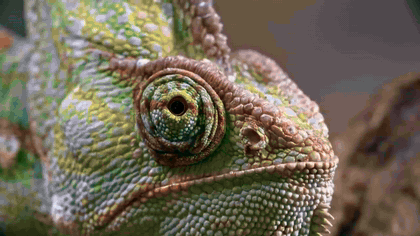 | **Dots**<br>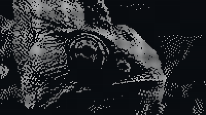 |
| 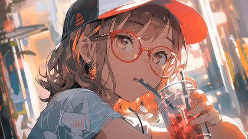 | **Quadrant mosaic**<br>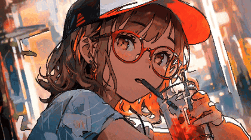 |

## What it does

- Braille, ASCII, blocks, halftone, emoji and many more looks, each tuned per picture — plus one
  slider to re-balance any look
- GIFs and videos become animated text art; save as GIF, MP4, WEBM (with the original sound), APNG,
  text, SVG, ZIP of frames, and more — with a "fit a size limit" helper for chat-app upload caps
- Copy straight into Discord, WhatsApp, X and other apps, with per-app checks and one-click fixes
- Crop, masks, captions, a picture on top (logo / watermark, as characters or sharp), colour
  palettes, batch conversion, projects, printing — in 7 interface languages
- Completely offline: nothing ever leaves your computer

## Free — also for commercial use

[MIT license](LICENSE): use it, change it, sell things made with it — no strings attached.
If you mention Text Art Studio when you use it somewhere, that is appreciated, never required.

This project was built with the help of an AI coding assistant (Anthropic's Claude).

## More of what it can do

**Open anything** — PNG, JPG, WEBP, AVIF, GIF, APNG, BMP, SVG, ICO, MP4, WEBM, MOV, MKV and more;
the webcam; pasted or dropped pictures; text art (.txt and ANSI .ans); whole folders as a batch;
and its own .textart project files that save everything.

**Looks and drawing** — braille dots, ASCII letters, shape-matching glyphs, edge sketches,
half-block and quadrant pixels, halftone dots, emoji mosaics, word fills, a pixel font; over
twenty tuned looks plus one slider that re-balances any of them; your own looks, shareable as a
link or a .textlook file; a character-set designer; mono, gradient and full-colour modes; retro
palettes (Game Boy, C64 …) and your own palettes.

**Adjust and edit** — width, brightness, contrast, gamma, saturation, auto levels, threshold,
five dither styles, direction-aware outlines, depth, sharpen, hide-plain-background; crop,
rotate, flip, masks, a wipe compare; captions; a picture on top (logo or watermark — as
characters or drawn sharp); per-cell editing with brushes; undo and redo of everything.

**Animation and video** — GIFs and videos play live with trim, speed, reverse, boomerang and a
smooth loop; settings can change over time, each change with its own start and end; the look
cards play along with the video; exports to GIF, APNG, animated WEBP, MP4 and WEBM keep the
original sound and are encoded as fast as the computer allows.

**Share and save** — copies adapted to Discord, WhatsApp, Telegram, X and more, with per-app
checks and a one-click "Fix all"; a fit-a-size-limit helper for upload caps that shows real
sizes; stills as PNG, JPG, WEBP or BMP; SVG (plain, animated, or plotter/laser lines); HTML,
ANSI, code strings (JavaScript, Python, C#, JSON), terminal scripts, a ZIP of all frames;
print and poster PDFs; before→after reveal videos; sticker and emoji sizes.

**Comfort** — interface in English, Türkçe, Deutsch, Español, Русский, 日本語 and 中文; light and
dark themes; find any tool by name with Ctrl+K; a guided tour; session restore after closing;
backups of your settings and looks; a full-screen/OBS view; and everything runs offline —
nothing ever leaves your computer.

## For developers

The page is built from `web/src/` into the single file `web/index.html`:

```
cd web
node build.mjs          # writes index.html (the app), test.html (app + tests) and sw.js
node test.mjs           # self-test, bit-exact regression check, feature checks, video checks
```

`node test.mjs` needs Node 22+ and Chrome or Edge (or `CHROME=<path>`); exit code 1 means a failure.
Single suites: `node test.mjs selftest`, `equiv`, `uitest`, `pwa`, `video`.

| Path | What it is |
| --- | --- |
| `web/src/page.html`, `web/src/styles.css` | markup and styles |
| `web/src/js/NN-*.js` | the script, joined in name order into one inline script |
| `web/src/i18n/<lang>.json` | the interface languages |
| `web/src/wasm/` | the SIMD edge detector |
| `desktop/` | the Electron shell around the same page |

Desktop app (Windows and Linux):

```
cd desktop
npm install
npm start               # run it (on Windows, double-clicking desktop\dev.cmd does all of this)
node smoke.mjs          # drive the real shell and check start, file open, camera, storage, restart
npm run dist:win        # Windows installer + portable .exe → desktop/dist/
```

Linux packages are built by CI: the `desktop` workflow in `.github/workflows/` builds both
platforms, and pushing a `desktop-v*` tag publishes a Release with the files and their checksums.
